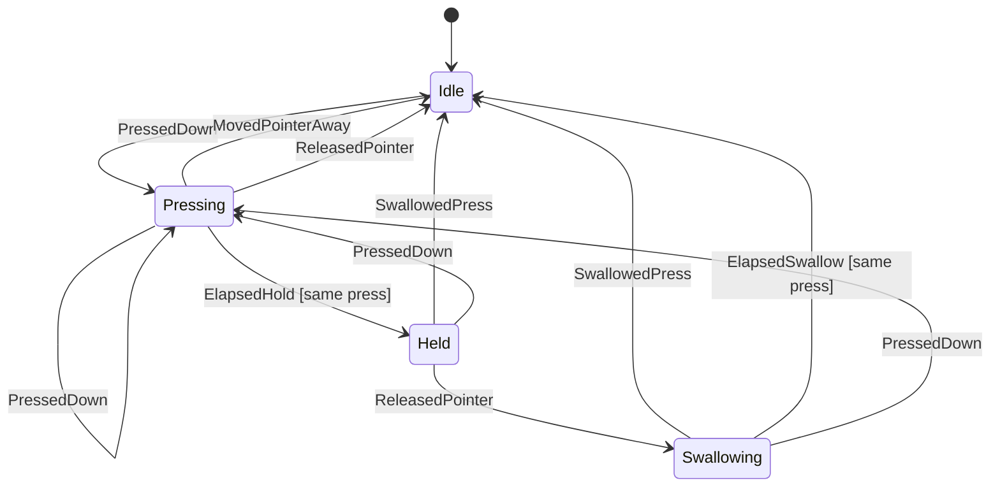

# Plan 14c | The Part declaration, one generic host per painter, and the first two blocks

Status: Proposed, and built as written here; the owner has not accepted it.
Slice 4 of `14-ui-v1.md`. Scribe issue #2595, under #2568. Audited once
(A-01 to A-24, answered under "Audit"). Layer: Foldkit core
(`packages/foldkit/src/behavior/` and `experimental/machine`), then the
three painters' hosts (Client adapters), then the two domain cores whose
pages a person holds a finger on (Books, Words).

## His words

His words to this task were relayed by the session that started it, on
2026-11-20. The ones below that are not also in
`user-messages/2026-11-20-ui-v1.md` were not checked against a recording
here, and are added to that file with this note.

On painters: "a painter should just take state and render a UI and then
when that state changes, it should render again. That's it." And: "It looks
at memoized selected state from the model that's reduced and folded over,
and then redraws when that changes."

On where a widget's state lives: "let's make sure that those widgets report
their state up in the state tree so we can synchronize all this stuff." Of
an earlier plan that kept some of it in painters: "that's preposterous...
That's a bad plan."

On screens: "the screen should really just wire together components that
don't need any other internal plumbing because that's all part of the core
logic."

On speed: "what kind of optimizations can we do here with memoization and
referential integrity".

On Zag: "we can improve those ideas and make them more ergonomic"; from Zag
take "also the set of components as well". And: "are we doing the ZagJS
approach here, where we're defining the state? Is there a machine we can
bring in from effect machine or in FoldKit upstream to help us model those
widgets?" (Two lines an earlier draft quoted, "Porting zag wrapping it no
porting its semantics yes" and "take the pure step function, type parts,
and prop getters as a projection", are him reading an earlier answer aloud.
His own reply there was "We're going to or port its semantics".)

On what syncs: "What wouldn't sync to all devices?" On typing: "we can use
these for like inputs and figure out built-in debouncing and make sure
everything is really, really snappy and synchronizing". On dragging: "Yeah,
I want like drag things." Decided the same day, as relayed: typing syncs
when it pauses and does not wait for the field to be left; sync is as quick
as it can be; a drag's grain and rate are set in the part's declaration,
with a quick default; styling stays small and composable on top for now;
and good upstream improvements are to be ported, the Machine first.

On `packages/ui`: "Keep and move one widget at a time. Rewrite it all now",
confirmed "Yes, do all of them."

On agent Actions: "we want to make sure that those are UI related and not
domain related Yeah, our catalog already does this".

## What changes from plan 14, said first

Plan 14 was written before most of the sentences above. This page replaces
four things in it for every part from here on:

1. **A painter is no home for state.** A part's state is a Model field.
   The only choice left is whether a Message is synced or stays on the
   device, and synced is the default. Example: `longPress` was "painter:
   the timer only". Its state is now a Model field, and its 500 ms is a
   Command.
2. **A block's rule does not return instructions.** With state in the
   Model, what a painter must do is read from the screen tree, like every
   other painted fact. Example: a completed hold is a field on the List it
   was held on.
3. **Every stateful block is a Machine.** "A block cannot use
   `Machine.define`" is withdrawn: its reason was that a block must also
   run where there are no Commands, and no part runs there any more.
4. **A screen adds a part with one composition call**, and a few lines
   where it draws it. Nothing about its Messages, Commands, Subscriptions
   or synchronization is written per screen.

Two blocks built before this page are stateful and are not Machines:
`Reader` (#2585, a plain `step`, state in the Model) and
`TranscriptFollow` (its state in the painters' runner). This slice touches
neither. Each becomes a chart when it becomes a part.

## The machine: upstream's, ported first

Upstream Foldkit is `github.com/foldkit/foldkit`, vendored read-only at
`repos/foldkit-upstream` (0.171 on Effect 4.1; this fork is 0.131 on Effect
4.0 beta). `Machine.define` here was upstream's from July 2026, 825 lines.
Upstream's had grown to 1,744 lines with what a part needs:

| Upstream has                                                                                                | A part uses it for                                                               |
| ----------------------------------------------------------------------------------------------------------- | -------------------------------------------------------------------------------- |
| a read-only `context`, given to guards and handlers                                                         | props: a menu's rows, which the chart must read and must not copy into its state |
| `Machine.fold` (read the field, transition, write it back)                                                  | a Submodel's chart in an `update`, with no hand-written lens                     |
| `forStates(...).on(...)`, shared edges                                                                      | "Escape closes it" said once for every open state                                |
| `ignore()`, and `step` reasons (`OutOfAlphabet`, `NotApplicable`, `GuardsFellThrough`, `ExplicitlyIgnored`) | a test that tells a late timer apart from a Message the part never knew          |
| `unreachableStates(extraRoots)`, `deadTransitions(extraRoots)`                                              | a state a restore or a link can enter is not reported as unreachable             |

So: yes, this is the Zag approach (a chart as data, guards for Zag's
conditions, Commands for its effects), on the machine already in Foldkit.
The vendored Effect source has no machine module
(`repos/effect-smol/packages/effect/src/unstable`).

**The port is the first commit of this task, on its own.** What stopped a
copy that changes nothing, and the answer to each:

- **Upstream's `Update.Return` is a record, `{ model, commands }`. This
  fork's is a tuple in every `update` it has.** An Edge handler answers
  upstream's record. `transition` and `Machine.fold` answer this fork's
  tuple, and `fold`'s type is a local `MachineFold`, since this fork has no
  `Update.Fold`.
- **This fork's `to(target, build, commands?)` differs from upstream's
  `to(target, handler)`.** `to` and `when` take both. A handler that
  answers a record and also has the third argument throws. So
  `examples/cardboard` and `examples/checkout-machine` are not edited.
- **Upstream's tests use helpers this fork lacks**: `defineTaggedUnion`,
  `defineMessageUnion`, a union's own `match`, `modifyFields` (`evo` here),
  and `Command.define` taking one record. `testKit.ts` gives the first two
  and the last from this fork's `ts` and `Command.define`. All 70 of
  upstream's tests are kept, changed only where they read a tuple.
- This fork's own 27 tests are kept beside them
  (`machineForkShapes.test.ts`), since they are what covers the older
  handler shape. Three now expect the `reason` on an ignored step.

Every Effect API upstream's `machine.ts` uses is in 4.0.0-beta.97; none had
to change. `Machine` stays under `experimental/`, as it is upstream.

## Which blocks are a Machine

| A block is               | When             | In this slice | Later, by this rule                                                  |
| ------------------------ | ---------------- | ------------- | -------------------------------------------------------------------- |
| a `Machine.define` chart | it keeps state   | `longPress`   | menu, dialog, popover, tooltip, `hoverIntent`, combobox, toast, drag |
| a pure function          | it keeps nothing | `placement`   | `layers`, `typeahead`'s match, `rovingFocus`'s `move`                |

`Block.problemsOf(block)` holds the rule for a block's chart: no state
nothing leads to, and no edge that can never fire. `LongPress`'s tests run
it, and the fixture's two parts are charts. The two stateful blocks that
are not charts are named above, each with what turns it into one.

**The Part wraps every block the same way**: it sees
`{ State, Message, chart, sync, atRest }` and nothing else.

## What syncs, and what stays on one device

Synced is the default: a part's Message is an ordinary logged Message
unless it declares otherwise. Each Message declares one of four, once
(`behavior/pace.ts`):

```ts
const Synced = ts('Synced') //                              the default
const Settled = ts('Settled', { afterMs: S.Number }) //     this device at once; the log when input pauses
const Sampled = ts('Sampled', { everyMs: S.Number }) //     this device at once; the log at most this often
const Device = ts('Device', { because: DeviceReason }) //   never the log
```

The whole list of what stays on one device. The first two rows are his;
the next three are what Books already keeps local today
(`examples/books/core/src/program.ts:147-177`) and the last is this
slice's:

| Reason            | What                                                                                              | Example                                                             |
| ----------------- | ------------------------------------------------------------------------------------------------- | ------------------------------------------------------------------- |
| `Secret`          | a secret or a sign-in address                                                                     | Books' `ConnectAudible({ address })`                                |
| `AboutThisDevice` | a fact about this device: the update it runs, light or dark, its size, whether its keyboard is up | `ObservedSystemMode`, `ObservedCodeStatus`                          |
| `OwnChoice`       | a choice made for this device                                                                     | `SetAppearance`: a phone in a dark room, a desk in daylight         |
| `OwnView`         | what one person is looking at here                                                                | a search of the page; reading away from the voice                   |
| `DeviceEffect`    | something done to this device alone                                                               | `CopyWordLink`, to this device's clipboard                          |
| `InputInProgress` | a touch, a hover or a keystroke that has not become anything yet                                  | `PressedDown`: a finger on this glass, before it is a hold or a tap |

Everything else syncs: a menu open, the highlighted row, focus (decided
today), a dialog, a drag in progress, text once it settles. A hover is
`InputInProgress`, so a tooltip does not open on a phone because a mouse
rests on a desk. Books' title menu is local today, "so a long press on a
phone opens nothing on a desk". That is the opposite of the new default,
and this slice does not change Books' declaration: it is his to say when
the menu part lands.

**Who a synced Message reaches is the session's to say, not the part's.**
A part declares a `category`: `Domain` reaches every device, `Navigation`
the devices the session mirrors (`runtime/start.ts:374-393`). The action
menu's seven Messages are synced and `Navigation`, so with Books' default
(`SharedDomain`) each device keeps its own menu, and with navigation
mirrored they follow.

`Part.synchronizationOf` derives what a Program tells sync from these
declarations, so no Program lists them by hand:

| Answer            | Derived                                                                                                                                  |
| ----------------- | ---------------------------------------------------------------------------------------------------------------------------------------- |
| `messageCategory` | the category an own Message declares; the child's answer for the child's                                                                 |
| `isLocalOnly`     | true for an own Message declared `Device`; the child's answer for the child's. Left out when neither has one to give                     |
| `keepOnRefold`    | the child's, lifted; then each part state all of whose Messages are `Device` is kept from the current Model. Left out when neither keeps |
| `projectLocal`    | the child's, lifted; then each part at rest (`Idle`, a closed menu), so a restart never opens on a half-made press                       |
| `paceOf`          | how each Message reaches the log, for the writer: a new, optional answer on `ProgramSynchronization`                                     |

A part that puts a `Device` Message and a synced one on one state loses
what the `Device` one did when the log refolds. `Part.define` refuses it
by name, since the cure is always two states.

### What a timer's answer does on another device

A Message a Command or a Subscription produces is never written to the
log: only what a Client sends is (`runtime/start.ts:1976-2027`), and a
Message folded from the log runs no Commands (`program/sync.ts:415-428`).
So "synced" cannot mean a timer's own answer. The rule for a part:

- **A Message a Command produces is `Device`.** `ElapsedHold` is.
- **What a wait leads to is sent by a Client as its own Message**, so it
  is logged and checked like any other. The hold does this: when it
  completes, the tree says so, and the painter that told the press sends
  the hold's press the ordinary way.
- **A wait that must end on every device** (a toast leaving, a tooltip's
  delay) stamps its deadline in the synced Message that started it, and
  each device runs its own wait to that deadline. No part in this slice
  has one; this is the rule the toast and the tooltip will be held to.

### Typing: this device at once, the log when it settles

Declared once on the Message, never per widget: `Typed({ text })` is
`Settled({ afterMs: 200 })`. 200 ms is the default, and a part's
configuration may set its own. Keys that move or decide (arrows, Enter,
Escape, Tab) are `Synced`, as the sync session recorded his rule: "arrow
keys mirrored, letters debounced".

- The keystroke is folded into this device's Model the moment it arrives,
  so the field never lags.
- The log gets one row for a burst of typing: the newest `Typed` for that
  field, written 200 ms after the last keystroke. It never waits for the
  field to be left.
- Any `Synced` Message writes every pending row first, whatever its part,
  so the log never holds a Send before the text it read.
- **A field that holds a secret says so on the part's instance**, and its
  `Typed` is then `Device({ because: 'Secret' })`. Not built: no text part
  exists yet.
- **Where the wait lives: in the Processor's sync writer, never a
  painter.** The rule is a pure function in core, `Pace.arrived` and
  `Pace.due`, which answer which rows to write and when to look again; the
  writer supplies the clock, and reads each Message's pace from `paceOf`.

`runtime/start.ts` belongs to #2571 and this slice does not edit it. So
this slice builds the declaration, `paceOf`, the two functions and their
tests. Until #2571's writer calls them, a `Settled` or `Sampled` Message
is written at once: correct, and one row per keystroke. No part in this
slice sends one. Two things that writer must also do, found in the audit:
resolve the promise of a row a newer one replaced, and keep unsent text
when a refold lands inside the 200 ms.

### Dragging: told at the grain the screen shows, written at a rate

Two limits, since a grain bounds rows per distance and not per second:

| Drag                      | Told to this device's Model when          | Written to the log                                                |
| ------------------------- | ----------------------------------------- | ----------------------------------------------------------------- |
| a slider                  | the value crosses a step, from its lowest | the newest step, at most once per `dragSampleMs`; the drop always |
| a row dragged over a list | the slot under it changes                 | the same                                                          |
| a seek bar                | each whole second, 1,000 ms               | the same                                                          |
| a free drag, no grain     | each sample that moved                    | the same                                                          |

- **The grain and the rate are the part's to set, in its declaration.** A
  part's configuration carries `pace`:
  `{ typingSettleMs: 200, dragGrain: Step({ size: 1, origin: 0 }), dragSampleMs: 50 }`
  are the defaults, the quick end, and base, preset and call layer over
  them: `Part.configure(Slider)('Coarse', { pace: { ...defaultPace, dragGrain: Step({ size: 10, origin: 0 }) } })`.
- `DraggedTo` is `Sampled({ everyMs: 50 })`: twenty rows a second at most,
  however fine the grain and however far the drag goes back and forth. A
  three second drag is 61 rows at most. `Dropped` is `Synced` and is never
  dropped by the sampler. A seek bar on a ten hour book crosses a second
  at every pixel, and is held to the same twenty a second.
- **Raw pointer positions between those are the painter's**, measured and
  never stored. `Pace.told(grain, toldValue, sample)` in core answers
  whether a sample is a new step; `toldValue` is the value the screen last
  painted, so the painter keeps nothing between samples. Two samples in
  one frame can tell the same step twice; the Model folds the second to no
  change and the sampler writes one.

One test per rule, in `behavior/pace.test.ts`: a burst of five `Typed`
settles to one row 200 ms after the last, with the field never left; a
`Synced` Message of any part flushes a pending `Typed` before itself; a
slider at step 5 dragged from 0 to 12 tells 5 and 10; one from 3 in fives
tells 8 and 13; a step of 0.1 lands on 0.3; a row dragged across three
slots tells three; a seek bar tells one value per second crossed; a three
second free drag is at most 61 rows and its drop is always written; and a
part configured with 250 ms writes at most 13. No drag part is built here:
`pointerDrag` arrives with the slider.

### What a painter may hold

A painter holds a raw sample only for as long as the platform's own event
sequence lasts, and reports the **edge** the rule asked about. Example:
while a finger is down the browser's host remembers where it went down,
and tells `MovedPointerAway()` once, the first time the finger is more
than the `slackPx` the binding declares (10) from that point. Two cases
where "the rule asks for a measurement and gets the answer as a fact" does
not fit, named:

- **`placement`'s rectangles.** Measured by the painter while it lays
  out, handed to the pure function, and applied in the same frame. Stored
  nowhere. A round trip through the Model would paint the menu at the
  corner for one frame, and nothing an agent or another device reads
  depends on the place.
- **The hold's slack.** Asking "where is the finger now?" when the timer
  ends would count a finger that left and came back as a hold, which
  today's code does not. So the threshold travels to the painter as data
  (`slackPx: 10`, `pointers: ['Touch', 'Pen']`, both declared in core) and
  the painter reports the crossing. The number and what a moved press
  means are in core; the subtraction is in the host.

## The declaration

All in `packages/foldkit/src/behavior/`, exported from `foldkit/behavior`
as `Gesture`, `Slot`, `Host`, `Block`, `LongPress`, `Placement`, `Pace`
and `Part`. Schema types, pure functions, no DOM, no React, no timer.

```ts
// gesture.ts: the closed list. It grows only here, with a painter for each addition.
const GestureKind = S.Literals([
  'Pressed', //            a tap or a click
  'PressedSecondary', //   the second button
  'HeldLong', //           a hold the platform recognized itself
  'PressedDown', //        the raw three, for a platform with no recognizer
  'MovedPointerAway',
  'ReleasedPointer',
])

// slot.ts: what the screen tree carries to a painter for one painted element.
const GesturePress = S.Struct({ gesture: GestureKind, press: S.String })
const HoldBinding = S.Struct({
  down: S.String, //       'fk-hold-down:ShowTitleMenu:salt-road'
  away: S.String, //       'fk-hold-away'
  up: S.String, //         'fk-hold-up'
  slackPx: S.Number, //    10
  pointers: S.Array(PointerKind), // ['Touch', 'Pen']
})
const SlotProps = S.Struct({
  isCurrent: S.optionalKey(S.Boolean),
  isExpanded: S.optionalKey(S.Boolean),
  isDisabled: S.optionalKey(S.Boolean),
  label: S.optionalKey(S.String),
  keys: S.optionalKey(S.Array(S.String)),
  id: S.optionalKey(S.String), //          names the slot's element
  activeId: S.optionalKey(S.String), //    the slot a container's highlight is on
})
const SlotBinding = S.Struct({
  ...SlotProps.fields,
  role: S.optionalKey(Role), //            'Menu' | 'MenuItem' | 'Tab' | 'Button'
  gestures: S.Array(GesturePress), //      [{ gesture: 'HeldLong', press: 'ShowTitleMenu:salt-road' }, ...]
  maybeHold: S.Option(HoldBinding), //     Some when a gesture is HeldLong
})

// block.ts: one small behavior that keeps state.
type Block<State, Message, R = never> = Readonly<{
  name: string
  State: Schema<State>
  Message: Schema<Message>
  chart: Machine<State, Message, R> //             it holds the state it starts at
  sync: Record<Message['_tag'], Sync>
  atRest: (state: State) => State
}>

// part.ts: a whole component, declared once.
type Part<State, Message, Props = void> = Readonly<{
  name: string //                                  'TitleMenu'
  State: Schema<State>
  Message: Schema<Message>
  chart: Machine<State, Message, never, Props> //  props are the chart's read-only context
  actions: ReadonlyArray<Catalog.AnyAction> //     what a person or an agent does on purpose
  sync: Record<Message['_tag'], Sync> //           how each Message syncs
  category: MessageCategory //                     'Domain' unless it says 'Navigation'
  slots: Record<string, SlotDeclaration> //        role, focus, gesture -> an Action's tag
  atRest: (state: State) => State //               what a restart opens on: the menu closed
  project: (state, props, slot, maybeChoice) => SlotProps
  configuration: Configuration<{ pace: Pace }> //  base, presets; the call layers over both
}>
const SlotDeclaration = S.Struct({
  role: S.optionalKey(Role),
  focus: S.Literals(['Container', 'None']), // the highlight is state; focus does not rove
  gestures: S.Array(S.Struct({ gesture: GestureKind, becomes: S.String })),
})
```

- **`Part.define(declaration)`** refuses, by name, what a declaration can
  get wrong: a gesture that `becomes` a tag none of its Actions has; an
  Action with no `what` or `why`; a Message of the chart with no word on
  how it syncs; one state with both a `Device` and a synced Message.
- **A part's Actions are Catalog Actions** (`Catalog.action(...)`), so a
  press on the tree is written as every other is, `ShowTitleMenu:salt-road`,
  and they join the Program's one Catalog. A fact is a Message of the
  chart that is no Action; an agent does not press it and nothing lists it.
- **`Part.bindingOf(part, slot, slotProps, maybeChoice)`** is the pure
  step from a projected slot to the `SlotBinding` a painter reads. It
  prints each press, and adds `maybeHold` when the slot listens for
  `HeldLong`.
- **`Slot.ariaOf(binding)`** writes the ARIA from the role and the
  projected state. Focus stays on a container, so its highlight is
  `aria-activedescendant`: a menu's
  `{ role: 'menu', 'aria-activedescendant': 'title-menu-open' }` and its
  row's `{ role: 'menuitem', id: 'title-menu-open' }`.
- **`Part.configure(part)(preset, call)`** layers base, then a named
  preset, then the call, and refuses an unknown preset by name.

Where this differs from plan 14's sketch of a part: there is no `blocks`
record, since the one shared block built so far (the hold) belongs to the
composition and not to any part; a fact has no record of its own, since
whether a Message is an Action is whether the Catalog has it; and `project`
answers one slot's props.

### The law of the projection: unchanged state in, identical projection out

`Part.view(part, state, props)` answers a part as a screen reads it.
**For the same state object, and props whose fields are each the same by
`Object.is`, it answers the same object**, and so does every binding it
hands out. Across a change of state, a slot whose binding did not change
keeps its object. Example: the title menu opens on Salt Road, and the
binding of A Tin Comet's row is the object it was.

`behavior/part.test.ts` holds the law: the same state twice gives the same
view and the same bindings; props in a new object with the same fields
count as unchanged; a state change keeps the object of the slot it did not
touch; and a `Lazy` node given a binding does not build again.

What that buys, measured by reading the painters, and what it does not:

| Where               | Skips today                                            | With an identical binding                                                  |
| ------------------- | ------------------------------------------------------ | -------------------------------------------------------------------------- |
| core, a `Lazy` node | when its `args` are the same by `Object.is`            | skips: a binding is a valid `Lazy` argument, and a test shows it           |
| React, a list row   | when the row object is the same (`ListRowView`'s memo) | does not skip by itself: a screen that builds a new row object repaints it |
| Phone, a list row   | the same, by shallow compare                           | the same                                                                   |
| HTML, a list row    | never: rows are not lazy                               | no change                                                                  |

So the law is necessary and, by itself, not enough: a row is skipped when
the screen wraps it in `Lazy` with the binding as an argument. A larger
saving is built here, in the composition: **a child's screen is built
again only when a field it reads changed.** A finger going down changes
only the hold, which no child reads, so `PressedDown` and `ReleasedPointer`
rebuild nothing. A test holds it. A row memo that compares fields is left
to the Menu's issue.

## A screen adds a part with one call

Composed once, for the whole Program (`packages/foldkit/src/test/shelf.ts`,
the fixture every painter's gesture test runs):

```ts
export const App = Part.compose({
  of: ShelfProgram,
  parts: [
    Part.given(TitleMenu, () => undefined),
    Part.given(Pin, () => undefined),
  ],
  screen: (model, views) =>
    shelfScreen(model, views['TitleMenu'] ?? noView, views['Pin'] ?? noView),
})
```

`Part.given` is where a part's props are read from the Model, once, for
both its chart and its projection; a second use of one part takes its own
key (`Part.given(TitleMenu, propsOf, 'wishMenu')`). And in the screen, a
menu on every row of a list, in full:

```ts
List({
  label: 'Library',
  items: Array.map(model.titles, title => ({
    key: title.slug,
    title: title.name,
    action: `Open:${title.slug}`,
    slot: menu.slot('Row', title.slug),
  })),
  ...menuOf(menu),
})
```

Ten lines, two of them the part's: `slot: menu.slot(...)` on the row,
and `...menuOf(menu)`, which is the open menu's node fields or nothing
while it is closed. The other eight are the list a screen without a menu
writes. The screen names no Message, no Command, no Subscription and
nothing of sync. A screen that forgets `...menuOf(menu)` has a menu that
opens in the Model and is not drawn; the Menu part will own its own node
so that cannot be forgotten.

## The two blocks

### `longPress`, a chart

Semantics ported from the two painter copies (`htmlEdge.ts` `runLongPress`,
`paintReact.tsx` `useMenuAsk`), which agreed: 500 ms, 10 px, a finger or a
pen and never a mouse, a press that moves or lifts early asks for nothing,
and the tap that ends a hold does not also press what is under it.

```ts
const Idle = ts('Idle', { pressCount: S.Number })
const Pressing = ts('Pressing', { press: S.String, pressCount: S.Number })
const Held = ts('Held', { press: S.String, pressCount: S.Number })
const Swallowing = ts('Swallowing', { pressCount: S.Number })

const PressedDown = m('PressedDown', { press: S.String }) //     a painter, at pointer down
const MovedPointerAway = m('MovedPointerAway') //                 a painter, once past slackPx
const ReleasedPointer = m('ReleasedPointer') //                   a painter, at up or cancel
const SwallowedPress = m('SwallowedPress') //                     a painter, when it stopped the hold's tap
const ElapsedHold = m('ElapsedHold', { pressCount: S.Number }) // the Command WaitForHold, 500 ms on
const ElapsedSwallow = m('ElapsedSwallow', { pressCount: S.Number }) // WaitToStopSwallowing, 250 ms on
```

Every one is `Device({ because: 'InputInProgress' })`.



- **`pressCount` is in every state**, so it rises through `Idle`. A tap,
  then a hold begun inside 500 ms of it, is press 2; the first press's
  `ElapsedHold({ pressCount: 1 })` meets `ignore()`, and `step` says
  `ExplicitlyIgnored`. A test holds exactly this.
- **A completed hold is told on the tree, and a Client sends its press.**
  While `Held`, `LongPress.signalOf` answers `{ press, pressCount }`, and
  the composition writes it as `hold` on each List, Transcript and bound
  Button. The painter that told the press sees it and sends `press` the
  ordinary way, once for each count. So a hold's Action is logged, is
  checked by the session's policy, and is one Message, exactly as the
  phone's own recognizer sends it.
- **The swallowed tap is the same field.** While `hold` is on the tree
  the next click is the hold's own: the browser's host stops it and tells
  `SwallowedPress()`. It stops one. So a link under a finger is covered,
  and so is a page that binds its clicks when it paints.
- **One number is new: 250 ms.** The painter copies kept their flag until
  the next click, however late. `Swallowing` now ends by itself, so where
  a browser sends no click after a hold the next tap is not eaten. If a
  finger's lift is never told, `Held` stays until the next finger goes
  down and eats one click, which is today's worst case.
- **The waits are Commands.** Each carries its length as data
  (`WaitForHold({ pressCount: 1, afterMs: 500 })`) and is built on
  `Command.answerAfter`, a new helper in core's `command` module, since
  the lint for `behavior/` forbids a sleep there and should.

What it costs, counted: a touch on a row with a menu is 2 Messages
(`PressedDown`, `ReleasedPointer`), 4 when the hold completes and its tap
is stopped, and the only row in the log is the hold's own Action. A mouse
sends none: a mouse asks with its second button. None of them rebuilds a
screen.

### `placement`, a pure function

```ts
const Rect = S.Struct({ left: S.Number, top: S.Number, width: S.Number, height: S.Number })
const Size = S.Struct({ width: S.Number, height: S.Number })
const Side = S.Literals(['Below', 'Above'])
place: (input: { anchor: Rect; size: Size; view: Size; gapPx?: number; edgePx?: number })
  => { left: number; top: number; side: Side }
```

Semantics ported from `placeMenuBy` and `AnchoredMenu`, which agreed: under
the anchor with an 8 px gap; above it when it does not fit below; never
nearer than 8 px to an edge. The two 8s leave both painters.

## The generic host

A painter's host is the only painter code that knows a part exists. It
reads a `SlotBinding` from the tree, binds the platform's events, and
presses the string the binding gives. It imports `Host`, `Slot` and
`LongPress` and no part's own module.

**Where a binding rides, and what that covers.** On the screen tree:
`slot` on a `Button` and on a `ListItem`, and `wordSlot` on a `Transcript`
(one binding for every word, since a recording has thirty thousand). So "a
second part needs no painter code" is true of a part whose slots are a
button, a list row or a transcript word, and of no other yet: a menu's own
rows, a text field, a seek bar and a box are each one more field and one
more call to the host, made when the first part needs them. The Menu, row
1 of the widget order, needs the first.

The tree's older fields stay as the way a Program that has not adopted a
part says "this row has a menu": `Slot.ofItem(item)` answers `item.slot`,
else the binding `menuAction` means (`HeldLong` and `PressedSecondary`,
both pressing it), and `Slot.ofWords(transcript)` the same for
`wordMenuAction`. So which gestures ask for a menu is decided once, in
core, and no painter reads `menuAction` again. Words keep today's join of
the word's token onto the press (`ShowWordMenu:w4012`); plan 14's typed
value is slice 6's.

**What each platform recognizes** is a table in each host, and
`Host.plan(binding, recognizes)` is the one function that turns the two
into what to listen for:

| Painter                    | File                                            | Recognizes itself                            | So a hold is                                     |
| -------------------------- | ----------------------------------------------- | -------------------------------------------- | ------------------------------------------------ |
| HTML                       | `packages/foldkit/src/renderers/htmlHost.ts`    | `Pressed`, `PressedSecondary`, the raw three | told to core's chart, which decides              |
| React                      | `packages/react/src/paintReact/host.tsx`        | the same                                     | the same                                         |
| Phone                      | `packages/react-native/src/interaction/host.ts` | `Pressed`, `HeldLong`                        | one `onLongPress`, straight to the Action        |
| Terminals, Svelte, OpenTUI | none                                            | nothing a slot adds                          | no hold and no second button; they ignore `slot` |

- **HTML** writes the binding as attributes (`data-slot-secondary`,
  `data-slot-hold-down`, `data-slot-slack`, the role and ARIA) and puts
  one Mount, `slotHostMount`, on the node's root. It sends the view
  `fk-slot-press` with each press, which the view answers through its own
  current handler, as `fk-transcript-press` works. A Transcript keeps its
  own listener for the second button, which leaves a right click on
  selected words to the browser.
- **React** writes the same attributes and runs the same DOM function,
  `bindSlots`, from one effect. Both are the browser, so there is one copy
  of the browser's mechanics, in core's HTML host. The React driver of the
  gesture test therefore proves that the effect is bound and the
  attributes are written; the event handling is the HTML driver's.
- **The phone** spreads `hostPropsOf(binding, paint)` on the `Pressable`
  or the word's `Text` it already draws: `onLongPress`, and the
  accessibility state. The phone has no second button and its table says
  so.
- **A terminal** is not changed and is not broken: `layout.ts` never read
  `menuAction`, the new fields are optional, no node kind is added, and
  `ActionMenu` reaches a terminal as `Interaction.menu`, which this slice
  does not touch.

**The proof of a second part** is `Pin` in the fixture: a part on another
kind of node than the menu's, a Button, that a hold or the second button
pins. It runs on all three painters with no edit to a painter, and
`behavior/host.source.test.ts` fails when a painter file spells a part's
name or imports a part's module.

## The composition call

`Part.compose({ of: child, parts, screen? })` wraps a Program the way
`ActionMenu.compose` does:

- **Model:** the child's fields, flat, plus one field `parts`: the hold's
  state under `hold`, and each part's under its key. **A state none of
  whose Messages sync is left out of the encoded Model.** So Books, which
  composes no part yet, encodes exactly what it did: a kept Model, a
  shared snapshot and the golden fold (`goldenFold.test.ts`, under
  `books-fold-v1`) are unchanged, and a Model kept before this slice
  decodes with the hold at rest.
- **Message:** the child's, the hold's six, and each part's.
- **`update`:** a part's Message goes through its chart, with its props
  read from the Model as the chart's context.
- **The Catalog:** the child's Actions with each part's appended, by
  `Catalog.make`, as `Session.compose` does its own. A Program with no
  part Actions keeps the child's Catalog object.
- **`interaction.press`:** a hold's token becomes the hold's Message
  (`LongPress.messageOfToken`, the parser paired with the printer
  `LongPress.tokenOf`); else the part's Actions; else the child's.
- **`screen`:** the child's, built again only when a field it reads
  changed; or `screen(model, views)` when a screen reads its parts. While
  a hold is completed, `Slot.withHold` says so on the tree.
- **Synchronization:** from `Part.synchronizationOf`, as in the table
  under "What syncs". The hold's Messages are `Navigation`, so a session
  that forbids a follower to move also forbids it a hold.

**Proved on `ActionMenu`.** `ActionMenu.compose` hand-wrote `isLocalOnly`,
`keepOnRefold` and `projectLocal`. It now declares how its seven Messages
sync (`ActionMenu.sync`) and what it rests at (the menu dismissed, a
function on the composed Model, since its state rides the navigation
stack), and takes the answers from `Part.synchronizationOf`. Its tests,
and `program/localOnly.test.ts`, pass unchanged. `ActionMenu` does not
become a `Part.define` here: its rows are `Interaction.menu`, not slots,
and moving that is the Menu's issue. `Session.compose` still writes its
own three answers by hand; it is not touched here.

**Who composes it in this slice.** With no timer in a painter, a hold on
the web works only where the Program carries the hold. Three Programs put
a menu on a row or a word:

- **Books and the transcript player** (React on the web): one line,
  `Part.compose({ of: BooksProgram })`, under Books' Session.
- **Words** (the HTML painter) is a `foldkit/html` app with its own
  `update`: its Model holds `hold: LongPress.State`, `GotHoldMessage`
  folds the chart, its reader's press reader reads a hold's token, and its
  Transcript node carries `LongPress.signalOf(model.hold)`. The swallowed
  tap and the completed hold's press are the host's, so Words writes
  nothing for them.

A page whose Program composes neither still opens its menus on the second
button and on the phone, and a hold there asks for nothing.

## What is deleted

Found by what the code does, since plan 14's line ranges had moved.

| File                                           | What                                                                                         |
| ---------------------------------------------- | -------------------------------------------------------------------------------------------- |
| `packages/foldkit/src/renderers/htmlEdge.ts`   | `LONG_PRESS_MS`, `LONG_PRESS_SLACK_PX`, `rowWithMenuOfTarget`, `runLongPress`                |
| the same                                       | `MENU_GAP_PX`, `MENU_EDGE_PX`, the geometry in `placeMenuBy` (it still measures and applies) |
| the same                                       | the long press in `transcriptMount`; `listMount` and `listMountName`                         |
| `packages/react/src/paintReact/paintReact.tsx` | `longPressMs`, `longPressSlackPx`, `useMenuAsk`, `tokenOfTarget`, `rowKeyOfTarget`           |
| the same                                       | `menuGapPx`, `menuEdgePx`, `MenuPlace`, the geometry and the `place` state in `AnchoredMenu` |
| `packages/react-native/src/interaction`        | the two hand-written `onLongPress` props, replaced by `hostPropsOf`                          |

`listMount` was exported from `foldkit/renderers/html`; it goes, and the
changeset says so. The three host files are new and so start at zero in
the painter ratchet: each has its entry in
`scripts/painter-ratchet/painters.json` saying what it holds and why (the
listeners, and the one sample the browser's host keeps while a finger is
down).

Tests that drove the deleted timers are rewritten to what a painter does
now: `htmlItemMenu.test.ts` and `htmlWordMenu.test.ts` (a hold is told to
core, the second button sends its press), and two in `readAlong.test.tsx`
(a finger held on a word or a row tells core and starts no timer).

## The gesture test

One table of what a person does, `Host.personActs` (`Hold`,
`SecondaryPress`), and one made-up Program, the shelf, exported as `Shelf`
from `foldkit/test`. Each painter has a driver that paints the shelf with
its own painter, fakes that platform's events, feeds every press to the
shelf's `update`, ends the waits the Model asked for on a test clock, and
asserts the same thing: the Model ends with the menu open on `salt-road`,
and the Actions folded are `['ShowTitleMenu']`.

| Driver                                               | A hold is                                                           | The second button is                                        |
| ---------------------------------------------------- | ------------------------------------------------------------------- | ----------------------------------------------------------- |
| `renderers/htmlHost.gesture.test.ts`                 | `pointerdown` with `pointerType: 'touch'`, 500 ms on the test clock | a `contextmenu` event                                       |
| `react/src/paintReact/host.gesture.test.tsx`         | the same two, through the rendered component                        | the same                                                    |
| `react-native/src/interaction/host.gesture.test.tsx` | the `onLongPress` the host put on the row                           | not there: the table says so, and the test holds it to that |

It is three files, one per painter package, since the React tests run in
jsdom and the phone's with React Native mocked. The table and the shelf
are one. A press that moves, one that lifts early, a mouse, a hold begun
right after a tap, and the swallowed tap are covered by the HTML and React
drivers; on the phone they are the platform's recognizer, which a test
that calls a prop cannot reach.

## The widget order

In `14a-ui-coverage.md`: one ordered list of 54 parts over Zag's 51
machines, Radix's 59 packages and the 25 `packages/ui` namespaces, each
with the blocks it needs and which exist, and 54 left.

## What I need from Action and Observation

The sync session proposes that a Message declares itself an Action (a
person did it) or an Observation (a resource reported it), as a data type
in core. `Part.compose` reads three things per Message today, from two
places: whether the Catalog has it, its `sync`, and the part's `category`.
What it needs from that declaration to read them from one:

1. **The kind, readable from the Message's Schema at run time.** Then the
   Catalog entries are derived from kind, and a part's `actions` list
   goes. Example: `ElapsedHold` is an Observation, from a timer;
   `ShowTitleMenu` is an Action.
2. **How it syncs, on the same value** (`Synced`, `Settled`, `Sampled`,
   `Device` with its reason), and its category. If the declaration carries
   only the kind, the part keeps its `sync` record.
3. **A word on a person's raw input.** `PressedDown` is something a
   person did, and is not something done on purpose to the part: no agent
   presses it and no Catalog lists it. If there are only two kinds it is
   an Observation whose source is a pointer, and I need that to be
   allowed.
4. **Whether a Client sent it or a Command produced it**, since only the
   first reaches the log today. With that, `Part.define` can refuse a
   synced Message a Command produces, which is the mistake "What a timer's
   answer does on another device" describes.

## Not in this slice

- No widget is ported, and no text field or drag part is built: the pace
  rules are declared and tested as pure functions.
- The sync writer does not yet call `Pace.arrived` and `Pace.due`:
  `runtime/start.ts` is #2571's.
- Dismissing a menu (Escape, an outside press) stays in the painters. It
  is `layers`, slice 5.
- `rovingFocus`, focus as synced state (#2592), playback and clocks
  (#2571), the terminal's focus (#2591).
- Plan 14's `books actions --json` field that marks a UI Action. The
  slice 4 row does not ask for it; it needs open decision 4 answered.
- The other thirteen gestures plan 14 lists. Each arrives with the block
  that needs it, with a painter for it, as the list's own rule says.
- No styling. The hosts write roles, ARIA and the `fk-` class names the
  painters already have; how a part looks is applied on top, later.

## Audit

One fresh agent read this page against the code (2026-11-20, 79 reads,
nothing run). Two Blockers and twelve Majors. Each finding, and the answer:

- **A-01, Blocker. `pressCount` could not rise across `Idle`, so a tap's
  timer completed the next press early.** Taken. Every state carries the
  count, and the chart's and the HTML driver's tests hold "a tap, then a
  hold inside 500 ms".
- **A-02, Blocker. Words lost the swallowed tap, and so did a link and any
  page that binds clicks when it paints.** Taken. The swallow is no longer
  in `interaction.press`: the tree says a hold completed and the browser's
  host stops the one click that follows.
- **A-03, Major. A press made inside the fold of `ElapsedHold` was not
  logged, journaled or checked by policy.** Taken, with the auditor's fix:
  the completed hold rides the tree and the host sends its press through
  the ordinary `press`.
- **A-04, Major. "Synced" cannot hold for a Message a Command or
  Subscription produces.** Taken as a rule, under "What a timer's answer
  does on another device". No part here breaks it. The check in
  `Part.define` waits on the Action and Observation declaration, point 4.
- **A-05, Major. `Held` had no exit but a release, and swallowed every
  press.** Taken. A hold stops one click; `Held` also ends on that click;
  the host tells the lift when it is unbound.
- **A-06, Major. The derivation left out `messageCategory`.** Taken. A
  part declares a category and `synchronizationOf` derives it. "Who a
  synced Message reaches" is said per session mode.
- **A-07, Major. Props were given in the screen but the chart needs them
  in `update`.** Taken. `Part.given(part, propsOf)` declares the lens once
  at compose, and a screen that reads parts is given the composed Model
  and the views.
- **A-08, Major. One state per part name.** Taken. State is keyed by an
  instance key, the part's name unless `Part.given` is told another.
- **A-09, Major. The identity law made no painter skip in the page's own
  screen, and every touch rebuilt the screen.** Taken in part. The
  composition now builds a child's screen again only when a field it reads
  changed, with a test that a finger going down rebuilds nothing. The
  table under the law says where a binding's identity skips and where it
  does not. A row memo that compares fields is left to the Menu's issue.
- **A-10, Major. "No painter code" is true only for a Button, a list row
  or a word.** Taken. The claim is scoped where it is made, and the proof
  part is on a Button, a different node kind from the menu's row.
- **A-11, Major. `parts` in Books' Model would fail the golden fold.**
  Taken. A device-only state is left out of the encoded Model, so the
  encoded Model is what it was. Measured: `goldenFold.test.ts` passes
  unchanged.
- **A-12, Major. The device list missed reasons the code uses, and
  secrecy cannot be per field.** Taken in part. Three reasons are added
  from what Books keeps local, hover is `InputInProgress`, and a secret
  field is said to be an instance's. The instance override is not built:
  no text part exists.
- **A-13, Major. A grain is not a rate limit.** Taken. Every `DraggedTo`
  is sampled as well, `told` counts whole steps from an origin, and the
  seek bar's case is said.
- **A-14, Major. Part Actions were listed, not joined to the Catalog.**
  Taken. A part's Actions are Catalog Actions and are appended to the
  child's Catalog.
- **A-15, Minor. The flush was per part; the writer had no carrier.**
  Taken. A synced Message flushes every pending row, `paceOf` is on
  `ProgramSynchronization`, and the writer's two cases are listed for
  #2571.
- **A-16, Minor. The derivation would change behavior if it always
  answered.** Taken. An answer is left out when neither side has one, rest
  is a function on the composed Model, and `Session.compose` is named as
  still hand-written.
- **A-17, Minor. More than two things stop a verbatim port.** Taken. The
  helpers are listed, this fork's 27 tests are kept, a record with a third
  argument throws, and `Block` has no second `initial`.
- **A-18, Minor. The phone driver cannot cover what each driver was said
  to.** Taken. The three cases are scoped to HTML and React, the rewritten
  tests are named, a word's `Text` is said, and the fixture is under
  `foldkit/test`.
- **A-19, Minor. New host files start at zero in the ratchet.** Taken.
  Each has its entry.
- **A-20, Minor. Two stateful blocks are not Machines.** Taken. Both are
  named.
- **A-21, Minor. The ARIA example was not the menu pattern.** Taken.
  `SlotProps` has `id` and `activeId`.
- **A-22, Minor. The widget order's rule was not followed, and it said
  "exists today".** Taken in `14a`.
- **A-23, Nit. Counts and names.** Taken. The snippet is counted again
  (ten lines, two the part's), `Pace`'s functions are named as they
  are, and the raw three stay in `GestureKind` because a painter's table
  names them.
- **A-24, Nit. Quotes.** Taken. The two read-aloud lines are marked, and
  the newer words are added to `user-messages/2026-11-20-ui-v1.md` as
  relayed.

What the audit did not check: nothing was run; real browsers after a hold
(whether iOS sends a click, when Android sends `contextmenu`); the wiki
and the recordings for the newer quotes.
